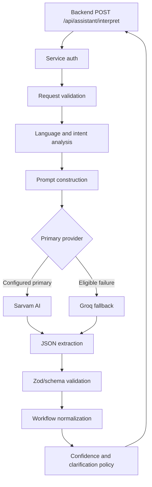
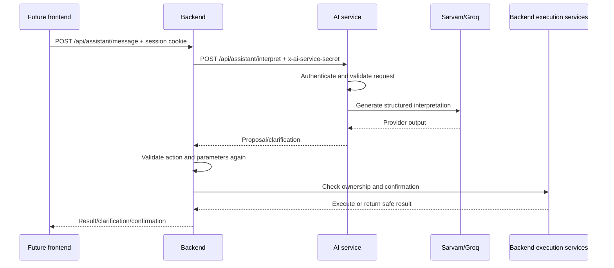

# BizPilot AI Service

The AI service is a separate Node.js/Express application that converts
natural-language business requests into validated, structured workflow
proposals. It is an interpretation service, not a business execution service.

The backend remains responsible for user identity, authorization, ownership,
database operations, invoice/payment execution, confirmation, and final
response safety.

> **Implementation status:** This README documents the current source. The
> backend-to-AI HTTP contract has a known `context` schema mismatch described
> in [How the Backend Communicates with the AI Service](#how-the-backend-communicates-with-the-ai-service).

## Table of Contents

- [AI Service Overview](#ai-service-overview)
- [Why a Separate AI Service](#why-bizpilot-ai-uses-a-separate-ai-service)
- [Responsibilities](#ai-service-responsibilities)
- [Technology Stack](#technology-stack)
- [Folder Structure](#folder-structure)
- [Architecture](#ai-service-architecture)
- [Provider Integrations](#sarvam-ai-integration)
- [Natural-Language Workflow](#natural-language-processing-workflow)
- [Structured Response](#structured-ai-response-and-validation)
- [Backend Authentication](#backend-service-authentication)
- [API Endpoints](#available-api-endpoints)
- [Request and Response Examples](#request-and-response-examples)
- [Environment Variables](#environment-variables)
- [Local Setup](#local-installation-and-setup)
- [Running and Testing](#running-the-ai-service)
- [Errors and Troubleshooting](#error-handling-and-troubleshooting)
- [Security and Limitations](#security-and-limitations)
- [Backend Communication](#how-the-backend-communicates-with-the-ai-service)

## AI Service Overview

The service receives a bounded message and optional conversation history,
detects language and intent, asks a configured provider for a structured
response, validates the response, applies confidence/confirmation policy, and
returns a proposal to the backend.

It does not:

- Authenticate browser users.
- Decide whether a user owns an invoice or business.
- Read PostgreSQL or Prisma.
- Send invoices or client messages.
- Mark payments as paid.
- Call Razorpay or email providers.

## Why BizPilot AI Uses a Separate AI Service

Separating interpretation from backend execution keeps provider credentials and
model-specific code away from business data. It also makes provider fallback,
prompt changes, response validation, rate limiting, and AI-specific tests
independent from the backend's authorization and transaction logic.

## AI Service Responsibilities

- Accept authenticated backend interpretation requests.
- Detect English, Hindi, Hinglish, mixed script, and unknown language cases.
- Detect intent hints and follow-up context.
- Build structured prompts.
- Call Sarvam as the configured primary provider and Groq as fallback.
- Parse and validate JSON model output.
- Normalize workflow parameters.
- Apply confidence and confirmation policy.
- Return clarification when the request is incomplete or low-confidence.
- Return sanitized errors and request IDs.

## Technology Stack

| Component | Current implementation |
|---|---|
| Runtime | Node.js, JavaScript ES modules |
| HTTP | Express 5 |
| Validation | Zod |
| Providers | Sarvam AI and Groq HTTP APIs |
| Limits | `express-rate-limit`, Express JSON limit |
| Security | Helmet, shared-secret service authentication |
| Tests | Node.js built-in test runner |

## Folder Structure

```text
ai-service/
├── src/
│   ├── app.js, server.js
│   ├── config/                 # Environment/provider settings
│   ├── middleware/             # Request ID, auth, limits, validation, errors
│   ├── modules/
│   │   ├── assistant/
│   │   │   ├── analyzers/      # Language, intent, request analysis
│   │   │   ├── output/         # JSON/output validation and confidence policy
│   │   │   └── workflow/       # Parameter normalization and rules
│   │   └── health/
│   ├── providers/
│   │   ├── sarvam/
│   │   └── groq/
│   ├── prompts/
│   ├── schemas/
│   ├── services/
│   └── utils/
└── tests/
```

## AI Service Architecture



## Sarvam AI Integration

`src/providers/sarvam/sarvam.provider.js` validates chat-completion input,
requires `SARVAM_API_KEY`, sends the configured model/messages, applies the
configured timeout, normalizes the response, and maps upstream failures to
safe `ApiError` values.

The provider uses the Sarvam API subscription key header. The key is never
returned in API responses or intended logs.

## Groq Integration

`src/providers/groq/groq.provider.js` follows the same validated chat-completion
shape and timeout/error approach. It requires `GROQ_API_KEY` and uses
`GROQ_MODEL` or the provider default.

## Primary Provider and Fallback Mechanism

`AI_PRIMARY_PROVIDER` and `AI_FALLBACK_PROVIDER` are validated as distinct
provider names. The current service orchestration wires Sarvam as primary and
Groq as fallback through the provider instances.

Fallback is eligible for timeout, network, HTTP 429, and upstream 5xx errors.
Missing primary credentials and invalid request/response validation errors do
not trigger fallback. If both providers fail, the service returns a sanitized
provider-unavailable error.

`AI_MAX_RETRIES` is loaded from configuration, but a general retry loop is not
implemented independently of provider fallback.

## Natural Language Processing Workflow


Language and intent are hints for interpretation, not authorization. The
backend must independently resolve every record and permission.

## Intent Detection and Workflow Interpretation

Supported workflow actions are:

- `GET_INVOICE`
- `GET_INVOICE_STATUS`
- `GET_PAYMENT_HISTORY`
- `GET_OUTSTANDING_BALANCE`
- `GET_DASHBOARD_SUMMARY`
- `CREATE_INVOICE_DRAFT`
- `PREPARE_PAYMENT_FOLLOWUP`
- `PREPARE_CLIENT_MESSAGE`
- `SEND_INVOICE`
- `CANCEL_INVOICE`

The workflow interpreter merges workflow parameters and recognized entities,
checks required fields, and converts incomplete requests to clarification.
`SEND_INVOICE` and `CANCEL_INVOICE` are always marked as requiring
confirmation by server-side policy.

## Structured AI Response and Validation

The AI response schema includes `type`, `intent`, `confidence`, `entities`,
`workflow`, `clarificationQuestion`, and `response`. Workflow data contains an
allowlisted `action`, `parameters`, and `requiresConfirmation`.

Example:

```json
{
  "type": "workflow",
  "intent": "GET_INVOICE_STATUS",
  "confidence": 0.91,
  "entities": { "invoiceId": "invoice-123" },
  "workflow": {
    "action": "GET_INVOICE_STATUS",
    "parameters": { "invoiceId": "invoice-123" },
    "requiresConfirmation": false
  },
  "clarificationQuestion": null,
  "response": "I can check that invoice."
}
```

Confidence below the configured policy threshold becomes clarification. The
service rejects unknown actions, inconsistent intent/workflow combinations,
invalid JSON, and invalid schema shapes.

## Backend Service Authentication

The internal endpoint requires:

```http
x-ai-service-secret: <shared server-side secret>
```

The backend reads `INTERNAL_SERVICE_SECRET`; the AI service reads
`AI_SERVICE_SECRET`. They must contain the same high-entropy value. The
receiver uses constant-time comparison and fails closed for missing or invalid
credentials. The browser must never receive this secret.

## Available API Endpoints

### Health

| Method | Endpoint | Auth | Purpose |
|---|---|---|---|
| GET | `/api/health` | None | Liveness response |
| GET | `/api/health/ready` | None | Application/configuration readiness response |

### Assistant

| Method | Endpoint | Auth | Request |
|---|---|---|---|
| POST | `/api/assistant/interpret` | `x-ai-service-secret` | Strict body with `message` and optional `conversationHistory` |

The assistant route is an internal service endpoint. It is not a browser API.
It is rate-limited to 60 requests per 15 minutes by the current middleware.

## Request and Response Examples

### Interpretation request

```http
POST http://localhost:5001/api/assistant/interpret
Content-Type: application/json
x-ai-service-secret: <shared-secret>
```

```json
{
  "message": "Show my overdue invoices",
  "conversationHistory": [
    { "role": "user", "content": "I need help with invoices" }
  ]
}
```

The current AI-service request schema is strict. It accepts `message` and
`conversationHistory`; extra fields such as `context` are rejected.

### Successful response

```json
{
  "success": true,
  "data": {
    "type": "workflow",
    "intent": "GET_INVOICE",
    "confidence": 0.9,
    "entities": {},
    "workflow": {
      "action": "GET_INVOICE",
      "parameters": {},
      "requiresConfirmation": false
    },
    "clarificationQuestion": null,
    "response": "I can look up your invoices.",
    "analysis": {},
    "workflowInterpretation": {
      "isWorkflow": true,
      "isComplete": true,
      "missingRequirements": [],
      "requiresConfirmation": false
    }
  }
}
```

The exact model/provider metadata may also appear in `data` after orchestration.
It is informational and must not be used by the browser for authorization or
payment decisions.

## Environment Variables

Use `ai-service/.env.example`. Never commit `.env` or real keys.

| Variable | Required | Purpose |
|---|---:|---|
| `NODE_ENV` | No | Runtime mode; defaults to `development` |
| `PORT` | No | AI-service port; example defaults to `5001` |
| `BACKEND_SERVICE_URL` | No/currently unused | Backend URL configuration; no AI callback is implemented |
| `AI_PRIMARY_PROVIDER` | No | `sarvam` or `groq`; defaults to `sarvam` |
| `AI_FALLBACK_PROVIDER` | No | Distinct fallback provider; defaults to `groq` |
| `SARVAM_API_KEY` | Provider use | Sarvam credential |
| `SARVAM_MODEL` | No | Sarvam model override |
| `GROQ_API_KEY` | Provider use | Groq credential |
| `GROQ_MODEL` | No | Groq model override |
| `AI_SERVICE_SECRET` | Production/internal calls | Shared backend-to-AI secret; minimum 32 characters when set |
| `AI_REQUEST_TIMEOUT_MS` | No | Provider timeout in milliseconds; defaults to 30000 |
| `AI_MAX_RETRIES` | No | Retry setting loaded by config; defaults to 1 |

The parser also accepts the legacy `AI_REQUEST_TIMEOUT` name as a fallback,
but `AI_REQUEST_TIMEOUT_MS` is the documented/current name.

## Local Installation and Setup

```powershell
cd ai-service
npm install
Copy-Item .env.example .env
# Fill AI_SERVICE_SECRET and provider values locally.
```

For backend integration, put the same secret in backend
`INTERNAL_SERVICE_SECRET`. Set the backend `AI_SERVICE_URL` to the actual
AI-service port. The repository's examples currently default to different
ports (`backend` points to `6000`, while this service defaults to `5001`), so
local configuration must be aligned manually.

## Running the AI Service

```powershell
cd ai-service
npm run dev
# or
npm start
```

With the example port, health is available at
`http://localhost:5001/api/health`.

## Running Tests

```powershell
cd ai-service
npm test
npm run check
```

The tests use deterministic provider stubs and HTTP handlers. They do not
require live Sarvam or Groq calls for ordinary CI.

## Error Handling and Troubleshooting

| Error/symptom | Meaning | Action |
|---|---|---|
| `SERVICE_AUTH_NOT_CONFIGURED` | AI service has no secret | Set `AI_SERVICE_SECRET` outside source control |
| `UNAUTHORIZED` | Missing/incorrect service header | Match backend and AI secret values |
| `VALIDATION_ERROR` | Request or provider input failed Zod validation | Check message/history shape and limits |
| `AI_PROVIDER_TIMEOUT` | Provider exceeded timeout | Check provider health or timeout configuration |
| `AI_PROVIDER_UNAVAILABLE` | Provider credentials/network/both-provider failure | Check provider keys and fallback configuration |
| `AI_RESPONSE_INVALID` | Provider returned invalid structured output | Inspect safe error metadata; do not bypass validation |
| `429` | AI route rate limit exceeded | Back off and retry later |
| Health works but assistant fails | Provider credentials or service secret missing | Check environment without logging values |

Errors intentionally do not expose provider keys, service secrets, raw
authorization headers, or unrestricted provider payloads.

## Security and Limitations

- Only the backend should call `/api/assistant/interpret`.
- The service has no database connection and cannot execute workflows.
- AI output is untrusted and must be validated again by the backend.
- Never trust model-generated payment status or transaction IDs.
- Never log API keys, service secrets, cookies, JWTs, or sensitive client data.
- A model's confirmation flag is not user consent; the backend enforces
  confirmation for sensitive actions.
- Live provider behavior depends on external credentials and network access.
- The frontend is not implemented in this repository.

## How the Backend Communicates with the AI Service

For the backend route inventory, frontend examples, database ownership rules,
and shared environment table, see the [backend README](../backend/README.md).



### Verified versus pending

Verified in source and tests:

- Service-secret middleware and constant-time comparison.
- Provider modules and fallback orchestration.
- AI request/response schemas and workflow rules.
- Backend client header, timeout, malformed-response, and response validation
  behavior.
- Backend-side confirmation policy.

Pending or incomplete:

- The backend client sends a `context` field, but the AI request schema is
  strict and currently rejects that extra field. Align the contract before
  treating `/api/assistant/message` as a fully working live path.
- Provider-backed end-to-end interpretation requires real provider credentials.
- Browser/frontend integration is not implemented.
