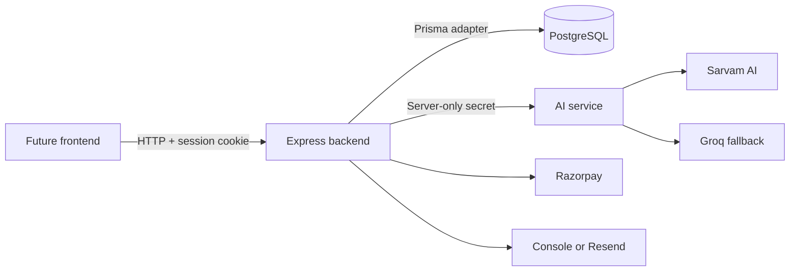
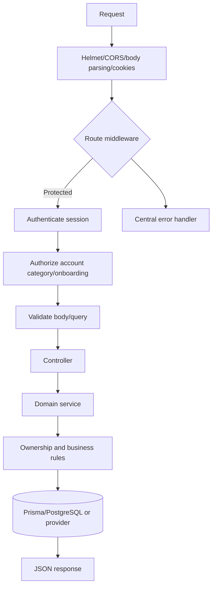
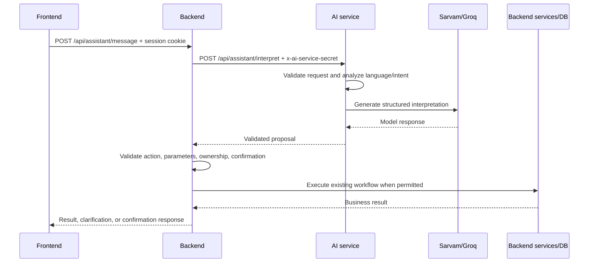

# BizPilot AI Backend

The backend is the authoritative API and business-logic service for BizPilot
AI. It authenticates users, enforces business/client ownership, stores data in
PostgreSQL through Prisma, coordinates invoices and payments, and is the only
service permitted to execute business workflows.

> **Implementation status:** This document describes the current source code.
> Features marked **Pending** or **Not Implemented** are intentionally not
> presented as available APIs.

## Table of Contents

- [Backend Overview](#backend-overview)
- [Backend Responsibilities](#backend-responsibilities)
- [Technology Stack](#technology-stack)
- [Backend Folder Structure](#backend-folder-structure)
- [System Architecture](#system-architecture)
- [Database Architecture](#database-architecture-postgresql--prisma)
- [Authentication and Authorization](#authentication-and-authorization)
- [API Routes and Endpoints](#api-routes-and-endpoints)
- [Business Workflow Execution](#business-workflow-execution)
- [Invoice Management](#invoice-management)
- [Payment Integration](#payment-integration-razorpay)
- [Email Integration](#email-integration)
- [Backend to AI Service Integration](#backend--ai-service-integration)
- [Environment Variables](#environment-variables)
- [Local Installation and Setup](#local-installation-and-setup)
- [Running the Backend](#running-the-backend)
- [Running Tests](#running-tests)
- [Common Errors and Troubleshooting](#common-errors-and-troubleshooting)
- [Security Considerations](#security-considerations)
- [Frontend Integration Guide](#frontend-integration-guide)

## Backend Overview

The backend is an ES-module Node.js application using Express 5. It exposes
the `/api` HTTP API, maintains cookie-based sessions, validates request data
with Zod, and delegates persistence to Prisma/PostgreSQL.

The backend starts only after `connectDatabase()` succeeds. The default local
port is `5000`.

## Backend Responsibilities

- Verify Google credentials and create/revoke authenticated sessions.
- Enforce account category (`BUSINESS` or `CLIENT`) and onboarding rules where
  the route requires them.
- Enforce invoice, payment, connection, and dashboard ownership in backend
  services.
- Create and manage invoice drafts and invoice lifecycle transitions.
- Create Razorpay orders, accept checkout verification, and process signed
  Razorpay webhooks.
- Prepare and execute the allowlisted assistant workflows.
- Call the AI service for natural-language interpretation.
- Return stable JSON responses and safe errors to clients.

The AI service does not access Prisma, PostgreSQL, Razorpay, email, or backend
business services.

## Technology Stack

| Component | Current implementation |
|---|---|
| Runtime | Node.js, JavaScript ES modules |
| HTTP | Express 5 |
| Validation | Zod |
| Database | PostgreSQL |
| ORM/client | Prisma 7 with `@prisma/adapter-pg` |
| Authentication | Google ID-token verification, JWT session cookie, database-backed sessions |
| Payments | Razorpay HTTP API and signed webhooks |
| Email | Console development adapter or Resend HTTP API |
| Tests | Node.js built-in test runner |

## Backend Folder Structure

```text
backend/
├── prisma/
│   ├── schema.prisma
│   └── migrations/
├── src/
│   ├── app.js                  # Express middleware and route mounting
│   ├── server.js               # Database connection and HTTP lifecycle
│   ├── config/                 # Environment, database, Google, Razorpay, email, AI
│   ├── middleware/             # Auth, authorization, validation, limits, errors
│   ├── integrations/
│   │   ├── ai/                 # Backend-to-AI HTTP client and response validation
│   │   ├── email/
│   │   ├── razorpay/
│   │   └── switch/
│   ├── modules/                # Routes, controllers, schemas, services by domain
│   ├── jobs/
│   ├── sockets/
│   ├── generated/              # Generated Prisma client; do not edit manually
│   └── utils/
└── tests/
```

`activity`, `messages`, and `notifications` modules exist in the source tree,
but their routes are not mounted by `src/app.js` and are therefore not public
HTTP APIs at present.

## System Architecture



### Backend request lifecycle



## Database Architecture (PostgreSQL + Prisma)

The schema is in [`prisma/schema.prisma`](./prisma/schema.prisma). Current
models include:

- `User`, `BusinessProfile`, `ClientProfile`, `AuthSession`
- `Connection`, `Invitation`
- `Invoice`, `InvoiceItem`
- `Payment`, `PaymentWebhookEvent`
- `Notification`, `AuditLog`

Important relationships:

- A user is either a `BUSINESS` or `CLIENT` account.
- A business owns invoices through `Invoice.businessUserId`.
- A registered client may be linked through `Invoice.clientUserId`.
- Payments carry business ownership and optionally client ownership.
- Connections determine business/client relationships.
- `AuditLog.ownerUserId` is nullable for legacy records.

Legacy records without an owner must remain ownerless. Do not assign them to
the first Google account or any arbitrary user, and do not expose them through
normal user queries without an explicitly approved ownership policy.

Migrations are under [`prisma/migrations`](./prisma/migrations). This README
does not authorize running migrations against a shared or production database.

## Authentication and Authorization

### Login and session flow

1. The client posts a Google credential to `POST /api/auth/google`.
2. The backend verifies the credential in `config/google.js`.
3. The backend creates or finds a user and creates an `AuthSession`.
4. A JWT is placed in the HTTP-only cookie named by `SESSION_COOKIE_NAME`.
5. Protected requests use `auth.middleware.js` to verify the JWT, check the
   database session hash, expiration, revocation, and active account status.

The cookie is configured with `httpOnly`, `SameSite=Lax`, and `secure` in
production. Explicit CSRF protection was not found and remains a production
review item for cookie-authenticated state-changing requests.

### Authorization

`authorize("BUSINESS")` and `authorize("CLIENT")` enforce account category.
`requireOnboarding` is applied to connections and invitations. Domain services
also check the authenticated user ID against invoice/payment ownership.

The backend must not use AI-generated user IDs, business IDs, client IDs,
roles, or permissions as authorization input.

## API Routes and Endpoints

All routes below are mounted below `API_PREFIX`, which defaults to `/api`.
Protected routes require the session cookie unless noted otherwise.

### Health

| Method | Endpoint | Auth | Request | Response |
|---|---|---|---|---|
| GET | `/api/health` | None | None | `{ success, message, data: { status, timestamp } }` |
| GET | `/api/health/ready` | None | None | Same shape; checks `SELECT 1`, returns 503 when DB is unavailable |

### Authentication and account setup

| Method | Endpoint | Auth | Request |
|---|---|---|---|
| POST | `/api/auth/google` | None | `{ credential: string, accountCategory?: "BUSINESS" \| "CLIENT" }` |
| GET | `/api/auth/me` | Session | None |
| POST | `/api/auth/logout` | Session | None |
| POST | `/api/users/onboarding` | Session | Business or client onboarding object |
| GET | `/api/business/profile` | Session + `BUSINESS` | None |

`/api/auth/google` returns the user under `data.user` and sets the session
cookie. A new user must provide `accountCategory`. Existing users are
identified by their verified Google subject/email.

Business onboarding fields include `businessType`, `businessName`, and
optional profile/address fields. Client onboarding accepts optional contact
and billing fields. See [`user.schema.js`](./src/modules/users/user.schema.js)
for exact limits.

### Connections and invitations

| Method | Endpoint | Auth | Request |
|---|---|---|---|
| GET | `/api/connections` | Session + onboarding | None |
| POST | `/api/connections` | Session + onboarding + `BUSINESS` | `{ username: string }` |
| PATCH | `/api/connections/:id/respond` | Session + onboarding + `CLIENT` | `{ decision: "ACCEPT" \| "REJECT" }` |
| POST | `/api/invitations` | Session + onboarding + `BUSINESS` | `{ email: string }` |
| POST | `/api/invitations/accept` | Session + onboarding + `CLIENT` | `{ token: string }` |

Invitation creation is rate-limited. Connection and invitation services enforce
the authenticated relationship and status.

### Invoices

| Method | Endpoint | Auth | Request/query |
|---|---|---|---|
| POST | `/api/invoices` | Session | Invoice draft body |
| GET | `/api/invoices` | Session | `page`, `limit`, optional `status`, `search` |
| GET | `/api/invoices/:id` | Session | Path invoice ID |
| GET | `/api/invoices/:id/pdf` | Session | Path invoice ID; PDF response |
| PATCH | `/api/invoices/:id` | Session | Partial invoice update body |
| POST | `/api/invoices/:id/send` | Session | None |
| POST | `/api/invoices/:id/cancel` | Session | None |

Invoice creation requires `clientName`, `clientEmail`, and at least one item
with `description`, `quantity`, and `unitPrice`. Optional fields include
`clientUserId`, `currency`, `dueDate`, `discountAmount`, `notes`, and `terms`.
Amounts are validated and calculated by the backend using `decimal.js`.

Successful JSON responses use the backend `ApiResponse` shape:

```json
{
  "success": true,
  "statusCode": 201,
  "message": "Invoice draft created successfully.",
  "data": {}
}
```

The PDF endpoint streams a generated PDF rather than a JSON `ApiResponse`.

### Payments

| Method | Endpoint | Auth | Request/query |
|---|---|---|---|
| POST | `/api/payments/invoices/:invoiceId/order` | Session | `{ amount?: string \| number, idempotencyKey: string }` |
| POST | `/api/payments/verify` | Session | `{ razorpayOrderId, razorpayPaymentId, razorpaySignature }` |
| GET | `/api/payments` | Session | `page`, `limit`, optional payment `status` |
| GET | `/api/payments/:id` | Session | Path payment ID |
| GET | `/api/payments/invoices/:invoiceId` | Session | Path invoice ID plus payment list query |
| POST | `/api/payments/webhooks/razorpay` | Razorpay signature | Raw JSON body, `X-Razorpay-Signature`, `x-razorpay-event-id` |

The webhook is mounted before JSON parsing so the signed raw body can be
verified. Payment state is controlled by verified Razorpay evidence and
webhooks. Natural-language input and AI output cannot mark a payment as paid.

### Dashboard

| Method | Endpoint | Auth | Query |
|---|---|---|---|
| GET | `/api/dashboard` | Session | `period` or `startDate/endDate`, `page`, `limit`, optional payment `status`, `includeCancelled` |
| GET | `/api/dashboard/invoices` | Session | Same dashboard query |
| GET | `/api/dashboard/transactions` | Session | Same dashboard query |

Supported periods are `current_month`, `previous_month`, and `current_year`.
Custom dates use `YYYY-MM-DD`; `period` cannot be combined with custom dates.

### Assistant

| Method | Endpoint | Auth | Request |
|---|---|---|---|
| POST | `/api/assistant/message` | Session | `{ message, conversationHistory?, confirmed? }` |
| POST | `/api/assistant/workflows/execute` | Session | `{ operation, input?, confirmed?, idempotencyKey? }` |

The structured workflow endpoint accepts these operations:

`GET_INVOICE`, `GET_INVOICE_STATUS`, `GET_PAYMENT_HISTORY`,
`GET_OUTSTANDING_BALANCE`, `GET_DASHBOARD_SUMMARY`, `CREATE_INVOICE_DRAFT`,
`PREPARE_PAYMENT_FOLLOWUP`, `PREPARE_CLIENT_MESSAGE`, `SEND_INVOICE`, and
`CANCEL_INVOICE`.

`SEND_INVOICE` and `CANCEL_INVOICE` return HTTP 409 with a confirmation result
unless `confirmed: true` is supplied. The natural-language endpoint first calls
the AI service, validates the proposal, then uses the same backend workflow
execution service.

### Response and error format

Successful module responses generally use:

```json
{
  "success": true,
  "message": "Human-readable result.",
  "data": {}
}
```

Errors use a safe shape similar to:

```json
{
  "success": false,
  "message": "Validation failed.",
  "code": "AI_RESPONSE_INVALID",
  "details": []
}
```

Validation errors are normally 400, unauthenticated requests are 401,
forbidden account/ownership requests are 403 or a not-found-safe 404, and
unexpected/provider/database failures are 5xx. Exact error messages are
implemented in each controller/service and should be treated as display text,
not stable machine identifiers unless a `code` is present.

## Business Workflow Execution

The backend is the execution authority:

1. Authenticate the session.
2. Obtain trusted `req.user`.
3. Validate the operation and action-specific input.
4. Resolve records using backend IDs and ownership checks.
5. Return clarification for incomplete assistant proposals.
6. Require explicit confirmation for send/cancel.
7. Call existing invoice/payment/dashboard services.
8. Return the result.

Preparation actions create or return drafts; they do not automatically send
messages. The AI service only proposes an action and parameters.

## Invoice Management

Invoice calculations are performed in `invoice.schema.js` using `decimal.js`.
Invoice totals include item subtotal, item tax, invoice discount, total,
amount paid, and balance due. Business owners and assigned clients are checked
by the invoice service before reads or mutations.

Do not resolve authorization from client name or email supplied by an AI
model. Use backend ownership and active connection rules.

## Payment Integration (Razorpay)

`integrations/razorpay/` wraps Razorpay order/payment requests and signature
verification. The payment service supports order creation, checkout signature
verification, listing, and webhook reconciliation for captured/failed events.
Idempotency keys protect payment-order creation from duplicate requests.

Refunds, payment links, QR codes, and automatic AI payment execution are not
implemented as backend assistant actions.

## Email Integration

The email service supports:

- `EMAIL_PROVIDER=console`: development mode logs that delivery was skipped.
- `EMAIL_PROVIDER=resend`: sends through the Resend HTTP API when
  `EMAIL_API_KEY` and `EMAIL_FROM` are configured.

In production, console delivery throws a configuration error. Invitation email
delivery uses this integration. No frontend or AI-service email client exists.

## Backend ↔ AI Service Integration



Implemented pieces:

- Backend client: `src/integrations/ai/ai.client.js`.
- Header: `x-ai-service-secret`.
- Backend secret: `INTERNAL_SERVICE_SECRET`.
- AI receiver secret: `AI_SERVICE_SECRET`.
- Backend timeout and response-size guard.
- Backend allowlist and Zod validation of AI output.
- Backend-side confirmation enforcement for send/cancel.

**Pending integration mismatch:** the backend client currently sends a
`context` property, but the AI service's strict `assistantRequestSchema`
currently accepts only `message` and `conversationHistory`. Until those
contracts are aligned, a live natural-language request carrying `context` can
be rejected by the AI service. The source-level client and HTTP contract tests
are present, but a real provider-backed end-to-end interpretation is not
verified.

The backend must not forward browser cookies, JWTs, Google tokens, or provider
keys. The AI service cannot modify the database because it has no Prisma
connection or business service imports.

See [`backend/docs/ai-service-integration.md`](./docs/ai-service-integration.md),
[`backend/docs/security.md`](./docs/security.md), and the
[AI service README](../ai-service/README.md).

## Environment Variables

Do not commit `.env` files or real values. The repository provides
`backend/.env.example`.

| Variable | Required | Purpose |
|---|---:|---|
| `NODE_ENV` | No | `development`, `test`, or `production`; defaults to `development` |
| `PORT` | No | Backend port; defaults to `5000` |
| `API_PREFIX` | No | API prefix; defaults to `/api` |
| `DATABASE_URL` | Yes | PostgreSQL URL |
| `FRONTEND_URL` | No | CORS origin; defaults to `http://localhost:5173` |
| `AI_SERVICE_URL` | No | AI service base URL; defaults to `http://localhost:6000` |
| `INTERNAL_SERVICE_SECRET` | Production/AI calls | Backend-to-AI shared secret; minimum 32 characters when set |
| `GOOGLE_CLIENT_ID` | Google login | Google OAuth client ID |
| `JWT_SECRET` | Yes | Minimum 32-character session signing secret |
| `SESSION_COOKIE_NAME` | No | Defaults to `bizpilot_session` |
| `SESSION_DURATION_DAYS` | No | Session lifetime; defaults to 7 |
| `EMAIL_PROVIDER` | No | `console` or `resend`; defaults to `console` |
| `EMAIL_API_KEY` | Resend only | Resend API key |
| `EMAIL_FROM` | Resend only | Sender address |
| `RAZORPAY_KEY_ID` | Payments | Razorpay key ID |
| `RAZORPAY_KEY_SECRET` | Payments | Razorpay key secret |
| `RAZORPAY_WEBHOOK_SECRET` | Webhooks | Razorpay webhook signing secret |

`GOOGLE_CLIENT_SECRET` appears in the example file but is not read by the
current backend environment schema. Do not assume it is required by this
implementation.

## Local Installation and Setup

Prerequisites:

- Node.js with built-in `fetch` support.
- Local PostgreSQL database.
- Google OAuth credentials if testing login.
- Optional Razorpay test credentials.
- Optional AI provider credentials.

```powershell
cd backend
npm install
Copy-Item .env.example .env
# Fill required values locally; never paste secrets into source control.
npm run db:validate
```

Database migrations are available through Prisma, but apply them only to the
intended local database.

## Running the Backend

```powershell
cd backend
npm run dev
# or
npm start
```

The default API base URL is `http://localhost:5000/api`.

## Running Tests

```powershell
cd backend
npm test
```

The test command uses Node's built-in test runner. Tests include authentication,
business, connections, invitations, dashboard, invoice, payment, workflow,
AI-client, response-validation, and cross-service HTTP contract coverage.
A database-backed production-like E2E run requires a dedicated test database;
the standard suite should not use live paid AI providers.

## Common Errors and Troubleshooting

| Symptom | Likely cause | Check |
|---|---|---|
| Backend exits during startup | Invalid/missing `DATABASE_URL` or DB unavailable | PostgreSQL, URL format, `npm run db:validate` |
| 401 on protected route | Missing/expired/revoked session cookie | Repeat Google login; call `/api/auth/me` |
| 403 on connection/invitation | Onboarding incomplete or wrong account category | Complete onboarding; use correct account type |
| AI service unavailable | AI service stopped, URL wrong, or secret missing | `AI_SERVICE_URL`, both service secrets, AI health endpoint |
| AI service rejects request | Shared secret invalid or request schema mismatch | `x-ai-service-secret`; see pending `context` mismatch above |
| Razorpay 503 | Test credentials missing or provider unavailable | Razorpay variables and test-mode account |
| Email not delivered | Console provider or incomplete Resend configuration | `EMAIL_PROVIDER`, `EMAIL_API_KEY`, `EMAIL_FROM` |
| Health ready returns 503 | Database readiness query failed | PostgreSQL connectivity and logs |

## Security Considerations

- Never expose `INTERNAL_SERVICE_SECRET` to the browser.
- Do not call Sarvam, Groq, Razorpay, or Resend directly from the frontend.
- Treat AI output as untrusted input.
- Re-check tenant ownership in backend services.
- Keep ownerless legacy records inaccessible until an explicit policy exists.
- Never let AI output change payment status.
- Do not log cookies, JWTs, service secrets, provider keys, or sensitive client
  data.
- Review CSRF protection before deploying cookie-authenticated mutations.
- Use Razorpay webhooks/signatures as the payment authority.

## Frontend Integration Guide

The `frontend/` directory currently contains only `.gitkeep`; a frontend
application is **Not Implemented** in this repository. The following guide is
for the future frontend and is grounded in the mounted backend routes.

### Browser-to-backend requests

Use the backend base URL and include credentials so the HTTP-only session
cookie is sent:

```js
const API_BASE_URL = "http://localhost:5000/api";

async function getCurrentUser() {
  const response = await fetch(`${API_BASE_URL}/auth/me`, {
    credentials: "include",
  });

  const body = await response.json();
  if (!response.ok) {
    throw new Error(body.message || "Unable to load the session.");
  }
  return body.data.user;
}
```

Google login posts the credential to the backend:

```js
await fetch(`${API_BASE_URL}/auth/google`, {
  method: "POST",
  credentials: "include",
  headers: { "Content-Type": "application/json" },
  body: JSON.stringify({
    credential: googleCredential,
    accountCategory: "BUSINESS",
  }),
});
```

Assistant requests use the backend route, never the AI-service route:

```js
const response = await fetch(`${API_BASE_URL}/assistant/message`, {
  method: "POST",
  credentials: "include",
  headers: { "Content-Type": "application/json" },
  body: JSON.stringify({
    message: "Show the status of invoice abc",
    conversationHistory: [],
    confirmed: false,
  }),
});

const body = await response.json();
if (response.status === 409 && body.data?.status === "confirmation_required") {
  // Show the preview and obtain a fresh explicit user confirmation.
}
```

The frontend should handle:

- `401`: redirect to login or clear local session state.
- `403`: show onboarding/account-category guidance.
- `409`: show confirmation UI; do not silently retry.
- `429`: show a retry message and back off.
- `5xx`: show a temporary service error and avoid duplicate mutations.

Payment statuses and invoice totals should be rendered from backend responses.
They must not be inferred from assistant text.

### Local service startup

```text
PostgreSQL: local installation, configured by backend DATABASE_URL
AI service:  http://localhost:5001 (ai-service/.env PORT)
Backend:     http://localhost:5000 (backend/.env PORT)
Frontend:    Not implemented; choose a dev server and set FRONTEND_URL accordingly
```

The current backend example defaults `AI_SERVICE_URL` to port `6000`, while the
current AI-service example defaults its own port to `5001`. Set
`backend/.env` `AI_SERVICE_URL` to the actual AI-service port before running
both services together. The browser only communicates with the backend.
