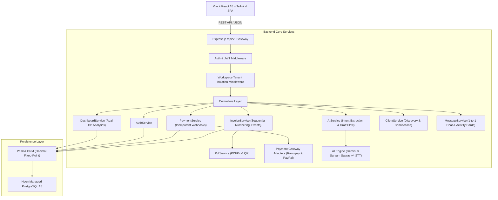

# BizPilot AI — Architectural Specification

## 1. Executive Summary & Design Philosophy
BizPilot AI is architected as a high-performance **Modular Monolith** designed to bridge small businesses, freelancers, agencies, and their clients through an intelligent financial operations engine. The core philosophy centers on strict authoritative financial integrity:
- **Zero AI-Driven Financial Record Manipulation**: The AI assistant interprets intent, flags missing information, and prepares structured draft previews, but authoritative financial calculations, decimal conversions, tax computations, and database commits are strictly executed by the backend business services.
- **Tenant Isolation**: Multi-tenant workspace isolation guarantees that invoices, payments, client relationships, and audit logs are scoped strictly to the authenticated tenant.
- **Dual-Capability Identity**: Users can seamlessly act as business operators (issuing invoices and collecting funds) and clients (receiving invoices and fulfilling verified payments).

---

## 2. High-Level Architecture Diagram

---

## 3. Core Modules & Component Interactions

### 3.1 Invoice Engine & Decimal Monetary Accuracy
- **Sequential Numbering**: Managed per workspace per calendar year via the `InvoiceSequence` table (e.g. `INV-2026-0001`). Gapless and concurrency-safe.
- **Financial Arithmetic**: `src/utils/decimal.js` performs exact cent/paise fixed-point calculations to eliminate IEEE-754 floating-point inaccuracies.
- **Lifecycle Transitions**: 
  `DRAFT -> SENT -> VIEWED -> PARTIALLY_PAID -> PAID -> OVERDUE -> CANCELLED`
  Invoices automatically dynamically reflect `OVERDUE` status when `dueDate < now()` and `balanceDue > 0`.
- **Audit Events**: Every status change or payment triggers an immutable `InvoiceEvent` row.

### 3.2 Payment Engine & Gateway Adapters
- **Unified Adapter Interface**: Standardized `PaymentAdapter` defining `createOrder()`, `verifyWebhook()`, and `getPaymentStatus()`.
- **Adapters**:
  - `RazorpayAdapter`: Real HMAC-SHA256 signature verification (`crypto.createHmac('sha256', secret)`).
  - `PayPalAdapter`: International currency conversion and webhook signature verification.
- **Idempotency**: Every incoming webhook and payment verification verifies `providerPaymentId` in the `Payment` table. Duplicate attempts return the existing receipt without double-crediting balances.

### 3.3 AI Business Assistant & Voice Engine
- **Multilingual Support**: Supports queries in English, Hindi, and Hinglish (e.g., *"Rahul ke liye 15000 rupees ka invoice banao for website development"*).
- **Speech-to-Text**: Sarvam Saaras v4 STT integration for high-accuracy Indian accented audio processing.
- **Confirmation Boundary**: When `CREATE_INVOICE` is identified, the assistant stores an `AIActionLog` draft with `isConfirmed = false`. Only after explicit user review and confirmation does the backend invoke `InvoiceService.createInvoice()`.

### 3.4 Multi-Tenant Workspace Security
- Access to business resources requires verification of either ownership (`ownerId == req.user.id`) or explicit role assignment in `WorkspaceMember` (`OWNER`, `ADMIN`, `FINANCE_MANAGER`, `MEMBER`).
- Clients can strictly only view invoices and payments where `clientId == req.user.id`.
